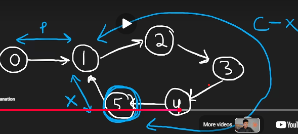

# Find the Duplicate Number (LC 287): Floyd's Cycle Detection

**Status:** Learned from solution, then worked out the proof myself (Nov 9, 2026)
**Pattern:** Fast & slow pointers → find the cycle START (not just detect a cycle)
**Related:** Linked List Cycle (LC 141), Linked List Cycle II (LC 142)

---

## 1. The trick that turns an array into a linked list

- Treat each index `i` as a node, and `nums[i]` as its `next`.
- Values are in 1..n, so nothing ever points to index 0, which makes 0 a safe start.
- The duplicate value = a node that **two indices point to** = **the start of the cycle**.
- So: "find the duplicate" becomes "find where the cycle begins".

---

## 2. My variables (NeetCode's picture)



- **p** = distance from start to the cycle start
- **C** = cycle length
- Slow and fast meet somewhere in the cycle
- **C − x** = distance from cycle start → forward → meeting point
- **x** = distance from meeting point → forward → back to cycle start

---

## 3. Distances when they meet

```
slow = p + (C − x)
fast = p + (C − x) + kC      (k = full loops fast did, k ≥ 1)
```

### Why 1: why does slow do NO full loop?
Think of the cycle as a circular running track with C spots.

- **t** = number of moves since slow entered the cycle (a stopwatch started at that moment).
  Slow moves 1 node per move, so **slow's distance inside the cycle = t**.
- When slow enters the cycle (t = 0), fast is already inside, **g₀** steps behind slow.
- On a track with C spots, the gap can only be 0..C−1, so `0 ≤ g₀ ≤ C − 1`.
- Each move: fast closes 2, slow opens 1, so **the gap shrinks by exactly 1**.
- So `gap(t) = g₀ − t` → they meet when the gap is 0 → `t = g₀ ≤ C − 1`.
- Slow walked t < C inside the cycle → **less than one loop**.

Example: C = 5, g₀ = 3

| t (moves) | gap = g₀ − t | slow's distance in cycle |
|---|---|---|
| 0 | 3 | 0 |
| 1 | 2 | 1 |
| 2 | 1 | 2 |
| 3 | 0 → meet | 3 |

> The gap starts at most C − 1 and drops by 1 per move, so it hits 0 before slow finishes a loop.

### Why 2: why is k ≥ 1?
Both end on the **same node**, but fast walked **more distance** than slow.
Same path + same end node + different distance → the difference must be whole loops.
Fast's extra distance is > 0, so it did at least 1 loop.

### Why 3: why fast = 2 × slow?
Both take the same number of moves. Slow moves 1 per move, fast moves 2 per move.
So fast's total distance is always twice slow's.

---

## 4. The algebra

```
p + (C − x) + kC = 2(p + C − x)
              kC = p + C − x
               p = (k − 1)C + x
```

- **k = 1:** `p = x`, so the tail length equals the distance from the meeting point to the cycle start.
- **k > 1:** `p = x + some full loops`, and full loops land you on the same node, so they don't change anything.

---

## 5. Why phase 2 works

- Leave `slow` at the meeting point. Put `slow2` at the start (index 0).
- Move both **1 step at a time**.
- After p steps:
  - `slow2` is at the cycle start (definition of p).
  - `slow` walked `x + (k − 1)C`: x gets it to the cycle start, and the loops bring it back to the same spot.
- Both are at the cycle start → they meet there → **that's the duplicate**.

---

## 6. Sanity check (NeetCode picture)

Cycle 1→2→3→4→5→1, start at 0 → 1.
- p = 1 (0→1), C = 5, meet at node 5
- C − x = 4 (1→5), x = 1 (5→1)
- p = x = 1 ✓

---

## 7. Where I got stuck (read this first next time!)

- I didn't get why slow can't loop. **Answer: the gap countdown** (gap ≤ C − 1, −1 per move).
- I didn't know what **t** was. **It's a stopwatch**: moves since slow entered the cycle.
- I thought fast could loop only once. **It can loop k times**, and the extra loops cancel out.
- The proof is really one equation: **`p = (k − 1)C + x`**. Everything else explains why each piece is true.

---

## 8. Interview ladder (say these in order)

1. Hash set → O(n) time, O(n) space ❌ (space)
2. Sort → modifies the array ❌ (not allowed)
3. Binary search on the value range (count ≤ mid) → O(n log n), O(1) space
4. **Floyd's** → **O(n) time, O(1) space** ✅ expected answer

**Complexity:** _derive this myself next revision_ (hint: phase 1 ≤ p + C steps, phase 2 = p steps)